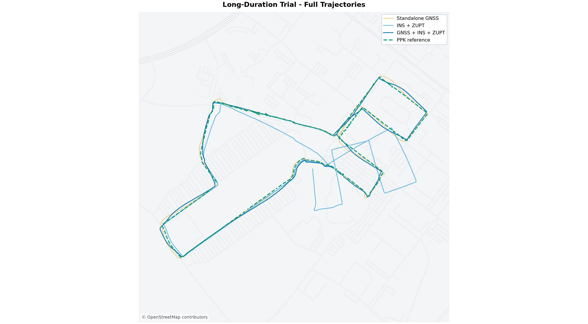
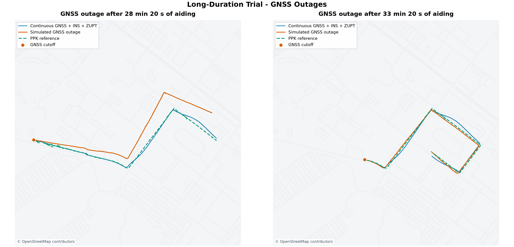
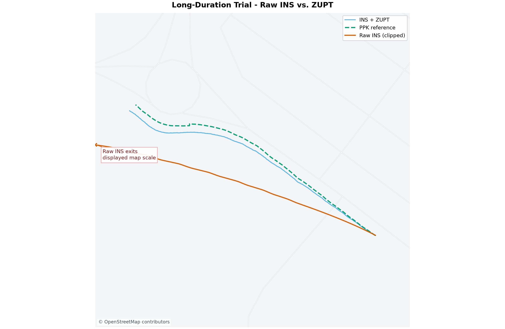
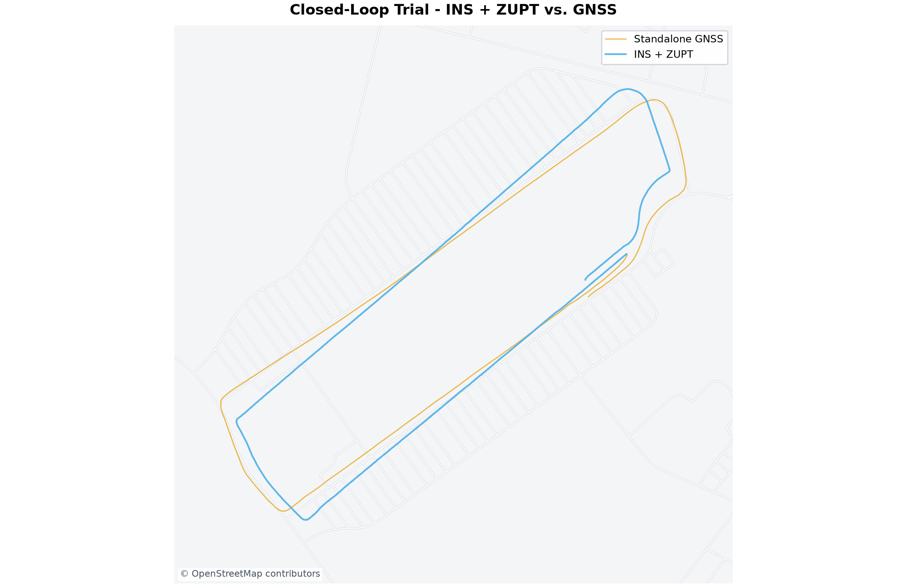

# GPS-INS-Boot
[](https://github.com/ehstevo/foot-mounted-ins/actions/workflows/public-tests.yml)

## Foot-Mounted Inertial Navigation and GNSS Fusion

GPS-INS-Boot is an independently developed foot-mounted inertial navigation
system built to investigate how a relatively low-cost IMU can estimate
pedestrian motion using physical constraints and complementary GNSS
measurements. The project implements raw strapdown inertial navigation,
zero-velocity updates (ZUPTs) in an error-state Kalman filter, and GNSS-aided
navigation with delayed measurement updates and clock-offset estimation.

A central question motivates this project: how much useful navigation
information can be recovered from a low-cost IMU alone, and how much can be
gained by exploiting the moments when a walking foot is stationary? These
methods were investigated using recorded walking experiments, including a
roughly 62-minute trial and several software-simulated GNSS outages.

## Experimental Results

### Long-Duration Walking Trial - Full-System Comparison

The Long-Duration Walking Trial is a roughly 62-minute walking experiment
recorded with a boot-mounted IMU and a separate GNSS receiver. The same
recording was used to compare several navigation approaches: unaided inertial
navigation, INS aided by ZUPTs, and INS aided by both ZUPTs and GNSS.

The full trajectory comparison below provides an overview of the experiment.
It shows how the different solutions reconstruct the same walk and where their
estimates begin to diverge.



*Long-Duration Walking Trial comparing ZUPT-only inertial navigation,
GNSS-aided inertial navigation, standalone GNSS, and the postprocessed GNSS
reference.*

**[Explore the interactive trajectory map](https://ehstevo.github.io/foot-mounted-ins/assets/maps/pi_long_interactive.html)**

The interactive map allows individual trajectory layers to be toggled
for a closer comparison of the navigation solutions.

Post-processed kinematic (PPK) GNSS provides a useful reference trajectory for
comparing these estimates. It is not perfect ground truth, particularly because
the GNSS antenna and foot-mounted IMU occupy different positions.

### Navigation During Software-Simulated GNSS Outages

One of the main experiments investigated how well the foot-mounted navigation
system could continue estimating its trajectory after losing access to GNSS.
Using the Long-Duration Walking Trial recording, the filter was replayed with
GNSS aiding available initially, then with subsequent GNSS corrections disabled
while inertial propagation and zero-velocity updates continued.

This outage was introduced during replay; the receiver was not physically
jammed or disabled.

The experiment was repeated with outages beginning at five different times to
investigate how the filter's previous aiding history influenced subsequent
performance.



*Long-Duration Walking Trial navigation during two software-simulated GNSS
outages. After the indicated cutoff, the filter continues using IMU
measurements and ZUPTs without further GNSS corrections. The PPK and
continuously aided trajectories provide context for the subsequent navigation
behavior.*

The results were surprisingly different. Four of the five trials remained
within approximately 4.5 to 7.2 meters of the PPK reference's horizontal
displacement after 15 minutes without GNSS corrections, while the earliest
outage differed by approximately 136 meters.

These differences raised an important question: what aspects of the estimated
navigation state, previous GNSS aiding, and subsequent walking motion determine
how well the system performs when GNSS disappears?

| GNSS outage begins | Prior GNSS aiding | 15-minute displacement discrepancy |
| ------------------ | ----------------- | ---------------------------------- |
| 1700 s             | 28 min 20 s       | 135.9 m                            |
| 1800 s             | 30 min            | 5.2 m                              |
| 1900 s             | 31 min 40 s       | 7.0 m                              |
| 2000 s             | 33 min 20 s       | 4.5 m                              |
| 2100 s             | 35 min            | 7.2 m                              |

*Discrepancy measures the difference between the estimated horizontal
displacement and the PPK reference displacement after the outage begins,
rather than absolute position error. Each cutoff also leaves a different
subsequent walking segment, so these results do not establish that more GNSS
aiding always produces better navigation.*

### The Impact of Zero-Velocity Updates

One of the most striking results came from the simplest comparison: running the
same recorded IMU measurements through an unaided strapdown INS and an INS
aided by zero-velocity updates.

Without aiding, small errors in acceleration, attitude, and sensor bias
accumulate through integration, causing the estimated position to diverge
rapidly. But when the filter recognizes moments when the foot is stationary
and applies zero-velocity updates, the navigation behavior changes
dramatically.

Nothing about the IMU itself changed. The improvement came from incorporating a
simple physical constraint into the estimator.



*The Long-Duration Walking Trial illustrates the effect of zero-velocity
updates on foot-mounted inertial navigation. The unaided INS diverges rapidly,
while the ZUPT-constrained solution remains on the scale of the walking
trajectory. The raw solution is intentionally clipped to preserve a useful map
scale.*

After just two minutes, the raw INS solution had calculated approximately
12 kilometers of horizontal displacement from its starting point, compared with
approximately 117 meters for the ZUPT-constrained solution. These are the
solutions' estimated displacements, not measurements of position error.

ZUPTs do not eliminate all drift, particularly in heading, but the difference
illustrates why physical constraints are so valuable when navigating with
inexpensive inertial sensors.

### GNSS Fusion - Benefits and Limitations

Adding GNSS measurements introduced another source of information, but the
results also revealed an important limitation: more sensor measurements do not
automatically produce a better estimate.

Across the Long-Duration Walking Trial, the continuously GNSS-aided filter did
not consistently agree more closely with the PPK reference than the standalone
GNSS receiver. Its full-run horizontal discrepancy RMSE was approximately
12.8 meters, compared with 10.6 meters for GNSS alone.

However, during one particularly difficult interval, fusion reduced the
receiver's larger deviations. Over that interval, the receiver's RMSE was
approximately 17.3 meters, while the fused solution's was approximately
9.4 meters.

This showed both the potential and the limitations of the current approach. A
filter can smooth unreliable measurements without necessarily correcting all
the resulting error. In fact, every GNSS update passed the configured
innovation-consistency test during this run, demonstrating that statistical
consistency alone is not enough to establish measurement integrity.

### Closed-Loop Walking Trial - Supporting Comparison

The system was also evaluated using a separate roughly 29-minute Closed-Loop
Walking Trial. This provided another opportunity to examine how the ZUPT-only
navigation solution behaved alongside the observed GNSS trajectory under
different experimental conditions.

Unlike the Long-Duration Walking Trial, this experiment does not have a saved
PPK reference. The receiver trajectory therefore provides useful context for
comparing the path shapes, but cannot independently establish positioning
accuracy.



*Closed-Loop Walking Trial trajectory map with the separately registered INS +
ZUPT estimate and standalone receiver GNSS. GNSS is qualitative geographic
context here, not ground truth or an accuracy reference.*

### Evaluation Note

PPK is a postprocessed antenna reference, not independently verified
foot-position truth, and its saved solution includes both fixed and float
positions. The GNSS antenna is not rigidly attached to the IMU, GNSS/IMU
measurement-time alignment remains a limitation, and the outage comparison
uses cutoff-relative horizontal displacement rather than absolute position
error.

## Motivation

An unaided inertial navigator integrates angular-rate and specific-force
errors. Even small accelerometer bias, gyro bias, leveling, and heading errors
therefore grow into large velocity and position errors. A foot-mounted IMU has
an unusually useful intermittent constraint: a planted foot is approximately
stationary during stance. Treating stance as a zero-velocity pseudo-measurement
can constrain velocity drift and, through filter cross-covariances, improve
some attitude and bias estimates.

That constraint does not determine absolute position or geographic heading on
its own. GNSS position observations can supply complementary global evidence,
but practical GNSS reception is vulnerable to multipath, non-line-of-sight
paths, timing uncertainty, and antenna-to-foot mismatch. This project focuses
on making those assumptions and limitations visible in the replay evidence
rather than hiding them behind a trajectory plot.

## Methods

### Inertial Navigation and Estimation

- **Delta-form strapdown mechanization.** The mechanizer consumes body-frame
  coning/sculling-corrected `(dtheta, dv, dt)` increments, propagating attitude,
  velocity, and position in that order. See
  [`mechanization.py`](src/bootins/estimation/mechanization.py).
- **Attitude convention.** Attitude is a scalar-first Hamilton quaternion
  `[w, x, y, z]` mapping body axes to the navigation frame. A body-frame angular
  increment composes on the right. The corresponding DCM is `C^n_b`; quaternion
  and Euler/display conversions are in
  [`frames/quaternion.py`](src/bootins/frames/quaternion.py).
- **Nominal/error-state ESEKF.** The nominal no-GNSS state contains position,
  velocity, quaternion attitude, accelerometer bias, and gyro bias (16
  components). Its 15-component error state contains additive position,
  velocity, small-angle attitude, accelerometer-bias, and gyro-bias errors.
  Measurement updates use Joseph-form covariance updates and reset the error
  mean by injecting the estimate into the nominal state. See
  [`esekf.py`](src/bootins/estimation/esekf.py) and
  [`error_dynamics.py`](src/bootins/estimation/error_dynamics.py).
- **Stance detection and ZUPTs.** A causal trailing-window SHOE/GLRT detector
  evaluates body angular-rate and specific-force evidence. Each flagged real
  IMU epoch can apply a three-axis velocity pseudo-measurement, `z = 0`.
  [`stance_glrt.py`](src/bootins/aiding/stance_glrt.py) and
  [`ins_zupt.py`](src/bootins/replay/ins_zupt.py) retain the detector and replay
  contracts separately.

### GNSS Aiding and Time

GNSS fixes are normalized as WGS-84 latitude, longitude, ellipsoidal height,
receiver-quality evidence, raw GPS week/time-of-week, and raw host-arrival
time. A fixed geographic NED origin is formed from terminal static receiver
evidence; it is an origin convention, not a multipath correction or foot-truth
measurement. WGS-84 ECEF/NED conversions are implemented in
[`geodesy.py`](src/bootins/frames/geodesy.py).

The aided filter extends the nominal state with a GNSS-to-IMU clock offset and
the error state with its uncertainty. A GNSS position measurement uses its
mapped measurement epoch, while recorded host arrival determines only when the
observation becomes causally available. The innovation is gated using

`NIS = y^T S^-1 y`, where `S = H P H^T + R`.

NIS measures consistency with the declared filter covariance and measurement
model. It is not an independent determination that a receiver fix is true or
free of multipath. The clock-aware measurement model and gating helpers are in
[`gnss_position_clock.py`](src/bootins/aiding/gnss_position_clock.py).

When an available fix maps to an earlier IMU epoch, replay applies it to the
first applicable retained posterior and reconstructs subsequent IMU/ZUPT
posteriors from their saved events. This is a discrete first-at-or-after snap,
not measurement-time interpolation. The fusion engine is in
[`gnss_fusion_engine.py`](src/bootins/replay/gnss_fusion_engine.py).

### Frames, Initialization, and IMU Gaps

Raw INS and ZUPT-only replay start in a run-local Forward-Right-Down (FRD)
frame obtained from a contiguous stationary interval. GNSS-aided replay uses a
separately initialized geographic North-East-Down (NED) frame: receiver course
is assumed to represent body-forward travel during a qualified segment, and a
terminal stance supplies static alignment and origin evidence. The initialization
logic is in [`initialization/`](src/bootins/estimation/initialization/).

The canonical replay paths reject malformed measurements and unsupported
sequence discontinuities. After a contiguous startup, they may coast exactly
one missing IMU notification from held prior motion rates, record the original
gap provenance, reset the stance detector, and never schedule GNSS at synthetic
time. This is reconstructed propagation across a short outage, not recovered
sensor data. See [`imu_gap_recovery.py`](src/bootins/replay/imu_gap_recovery.py).

## Architecture and Evidence Flow

```text
BLE IMU notification ──> timestamped imu.bmu ──> local decoder ──> tracked IMU frames
                                                                  │
GNSS UBX frames ──> gnss.ubxlog ──> gnss.ubx + gnss_fixes.csv ───┼──> startup / replay
                                                                  │
host arrival timestamps ── causal availability only ─────────────┤
IMU dt ─────────────────── integration timeline ─────────────────┤
GNSS GPS time ──────────── measurement epoch ────────────────────┘
                                                                  │
                                      raw INS / INS + ZUPT / GNSS + INS + ZUPT
                                                                  │
                                      CSV sidecars, diagnostics, static plots, maps
```

The capture path archives native receiver frames before deriving replay tables.
The table is intentionally distinct from the receiver-native archive so that
future parsing or PPK processing can return to the original evidence. During
replay, host timestamps establish causal availability order; they do not prove
IMU/GNSS measurement-time synchronization. IMU `dt` drives integration, and
receiver GPS time remains the GNSS measurement epoch.

## Canonical Workflows

The three navigation workflows consume immutable recorded evidence and produce
different scientific baselines:

| Workflow | Command | Result |
| --- | --- | --- |
| Raw INS | `scripts/run_raw_ins.py` | Strapdown propagation after static leveling; no covariance, ZUPTs, or GNSS. |
| INS + ZUPT | `scripts/run_zupt_replay.py` | Causal ESEKF predict plus optional velocity ZUPT at each real post-startup IMU epoch. |
| GNSS + INS + ZUPT | `scripts/run_gnss_zupt_replay.py` | Separate GNSS-aided startup, causal arrival scheduling, clock-aware delayed GNSS updates, and ZUPTs. |

Supporting scripts provide acquisition, capture inspection, detector tuning,
Allan-deviation analysis, GNSS parameter sweeps, and presentation-only
trajectory comparisons. They do not replace the canonical navigation paths.

## Installation and Public Tests

The project requires Python 3.12 or newer.

```bash
python3 -m venv .venv
. .venv/bin/activate
python -m pip install --upgrade pip
python -m pip install -e ".[dev]"
python -m pytest -q --ignore=tests/private
```

The public suite uses synthetic decoded IMU records and does not require the
private BMU interface, local hardware configuration, or captured data. A clean
public checkout can therefore run the mathematical, replay, capture-format,
and reporting tests, but cannot decode a real BMU payload without the locally
authorized device interface.

Install the optional `capture` and `plotting` extras with
`python -m pip install -e ".[capture,plotting]"` to use the corresponding
hardware-acquisition and visualization tools from a local checkout.

## Replaying Local Evidence

Captured data and populated profiles are deliberately excluded from Git. The
commands below require a locally available `.bmu` capture and, for aided replay,
a normalized `gnss_fixes.csv` table from the same acquisition bundle.

### Raw INS

```bash
python scripts/run_raw_ins.py path/to/run.bmu \
  --initialization-duration-s 3.0 \
  --csv-output results/raw_ins.csv
```

The caller declares the required static duration. The output is a run-local FRD
nominal trajectory with a schema sidecar; it is not geographic NED data.

### INS + ZUPT

```bash
cp config/ins_zupt/example.yaml config/ins_zupt/local.yaml
# Replace every null in the ignored local profile with declared settings.
python scripts/run_zupt_replay.py path/to/run.bmu \
  --config config/ins_zupt/local.yaml \
  --csv-output results/zupt.csv \
  --plot-output plots/zupt.png
```

The tracked profile is a schema with intentionally unfilled values, not a
default tuning recommendation. The local profile is ignored because it may
contain calibration or experiment-specific parameters.

### GNSS + INS + ZUPT

```bash
cp config/gnss_ins_zupt/example.yaml config/gnss_ins_zupt/local.yaml
# Replace every null in the ignored local profile with declared settings.
python scripts/run_gnss_zupt_replay.py \
  data/runs/<run-id>/imu.bmu \
  --gnss-fix-table data/runs/<run-id>/gnss_fixes.csv \
  --config config/gnss_ins_zupt/local.yaml \
  --csv-output results/aided.csv \
  --gnss-diagnostics-output results/aided_gnss.csv \
  --plot-output plots/aided.png \
  --html-map-output plots/aided.html
```

The optional static plot and interactive map are presentation artifacts. The
HTML map shows evidence layers and diagnostic outcomes, but external map tiles
are retrieved by the browser and GitHub does not render the result inline.

### Capture and Advanced Tools

Coordinated capture records timestamped raw IMU and GNSS evidence under one
host-monotonic clock. It does not run a live filter:

```bash
cp config/device_example.py config/device_local.py
# Fill only the ignored local device configuration.
python scripts/capture_gnss_imu.py --port /dev/ttyACM0 --label field_run
```

For a manifest-driven comparison map, copy the tracked schema to its existing
ignored destination. Its paths are interpreted relative to the copied manifest:

```bash
cp config/trajectory_comparison/example.yaml config/trajectory_comparison_local.yaml
python scripts/plot_trajectory_comparison.py \
  config/trajectory_comparison_local.yaml \
  --html-output plots/trajectory_comparison.html
```

For a bounded GNSS tuning sweep, keep both the base profile and plan local:

```bash
cp config/tuning/gnss_example.yaml config/tuning/gnss_local.yaml
python scripts/sweep_gnss_zupt.py \
  data/runs/<run-id>/imu.bmu \
  --gnss-fix-table data/runs/<run-id>/gnss_fixes.csv \
  --base-config config/gnss_ins_zupt/local.yaml \
  --plan config/tuning/gnss_local.yaml \
  --output-dir results/<run-id>-filter-sweep
```

`scripts/analyze_allan.py`, `scripts/tune_zupt.py`, and
`scripts/inspect_imu_replay.py` provide additional sensor-noise, detector, and
capture-integrity diagnostics. The scripts' `--help` output is the authoritative
reference for their full argument sets.

## Limitations

- The mechanization omits Earth rotation and transport-rate terms.
- ZUPTs do not independently observe geographic heading or absolute position.
- GNSS course alignment assumes the selected course represents body-forward
  motion; sideways or backward walking violates that assumption.
- The current antenna is not rigidly attached to the boot, so its position is
  not modeled as a fixed IMU lever arm.
- Receiver-reported uncertainty and NIS consistency do not guarantee GNSS
  integrity in multipath or non-line-of-sight environments.
- A shared host clock records source availability, not GNSS/IMU
  measurement-time synchronization.
- Static initialization, sensor calibration, covariance settings, and stance
  detector settings materially affect each experiment.
- Synthetic coast propagation is permitted only for one bounded missing
  notification after initialization and is retained as gap provenance.
- Real-data and PPK artifacts are local evidence; they are not bundled with the
  public repository and do not establish complete navigation accuracy.


## Lessons Learned

Developing and testing this system provided a deeper appreciation for several principles of inertial navigation and state estimation. Some became clear through the experimental results, while others emerged from the challenges of designing, implementing, and tuning the estimator.

### The Power of Physical Constraints

One of the most striking realizations was just how quickly an unaided inertial navigation system can become unusable. Even small errors in low-cost inertial measurements accumulate rapidly through integration, producing enormous position drift in a surprisingly short time.

Yet incorporating zero-velocity updates during foot stance dramatically changed the results. The IMU itself was no more accurate, and no additional positioning sensor was introduced. Instead, the estimator exploited a simple physical constraint: a planted foot is approximately stationary.

This demonstrated how much estimation performance can improve by recognizing and incorporating information about the physical system, rather than relying solely on increasingly accurate sensors.

### GNSS Aiding Should Improve the INS, Not Simply Correct Its Position

One of the most important lessons emerged while tuning the initial GNSS-aided filter. The early implementation placed comparatively large process uncertainty on position while keeping uncertainty in the other error states very small. As a result, GNSS measurements primarily corrected position, with limited influence on velocity, attitude, and inertial sensor bias estimates because the relevant cross-covariances remained small.

The resulting trajectory looked more like an INS solution being repeatedly pulled back toward GNSS positions than a properly integrated navigation estimate. This became particularly problematic when the GNSS measurements gradually drifted off course. The filter followed those measurements, and when the receiver subsequently returned toward the correct trajectory, the innovation gate rejected the corrections as inconsistent with the filter's displaced estimate.

Revisiting the covariance modeling and tuning produced a much more useful result. Rather than relying primarily on repeated position corrections, the filter could use GNSS information to improve its estimates of the errors developing within the INS. During the same problematic GNSS interval, the inertial solution maintained a trajectory much closer to the reference, although it was still influenced by the erroneous measurements.

This clarified an essential distinction: **the purpose of GNSS aiding is not merely to prevent the INS position from drifting between updates, but to help estimate and correct the underlying navigation errors so that subsequent inertial propagation becomes more reliable.** The extent to which this is possible depends on the system dynamics, available measurements, and covariance structure.

### Observability and the Importance of Heading Aiding

Although ZUPTs were remarkably effective at constraining velocity drift, the longer experiments exposed a persistent limitation: zero-velocity measurements alone do not provide an absolute heading reference.

This made the importance of observability much more tangible. An estimator may contain states for position, velocity, attitude, and sensor biases, but their inclusion in the state vector does not guarantee that the available measurements provide enough information to estimate them independently.

The heading limitation also helped explain why many practical navigation systems incorporate magnetometers or other independent heading-aiding sources. Without information that constrains heading, even relatively small orientation errors can accumulate into substantial horizontal trajectory deviations.

The broader lesson was that implementing a mathematically correct filter is not enough. Understanding which states are observable under the available measurements and motion conditions is fundamental to designing an effective navigation system.

### The Importance of Modeling Decisions

Implementing the ESEKF revealed just how many choices exist within what initially appears to be a relatively standard estimation problem.

There are different ways to represent and propagate navigation errors, model accelerometer and gyroscope imperfections, construct and discretize process-noise covariance, initialize uncertainty, and incorporate measurements. Even the choice between a conventional EKF and an error-state formulation introduces important considerations.

These are not simply interchangeable implementations of the same equations. Different assumptions and covariance models influence how uncertainty develops, how measurements affect the estimated state, and how the filter behaves when its assumptions are violated.

Working through these decisions made it clear that understanding Kalman filter equations is only a starting point. Developing intuition for selecting appropriate models, recognizing their limitations, and understanding their consequences is a much deeper part of estimation research.

### Knowing When to Trust a Measurement

A final lesson concerns the reliability of the information supplied to the filter. The GNSS experiments demonstrated that measurements can be statistically consistent with an estimator's predicted uncertainty while still containing significant errors.

A related challenge arises with inferred constraints such as ZUPTs. Missing a genuine stationary interval sacrifices an opportunity to correct drift, whereas incorrectly declaring the foot stationary can introduce a physically invalid measurement. Although this particular failure mode was not independently evaluated in the experiments, it illustrates the importance of measurement selection.

Together, these considerations reinforce a broader principle: **a reliable estimator must not only determine how to incorporate information, but also when that information deserves to be trusted.**

## Future Work

The current implementation provides a foundation for investigating several additional questions in inertial navigation and state estimation. Potential directions for future development include:

- **Heading Aiding:** Explore magnetometers and other heading references to improve orientation estimation and reduce drift during GNSS denial.
- **GNSS Integrity:** Develop methods to detect, reject, or downweight unreliable GNSS measurements, including gradual errors that evade conventional innovation gating.
- **Inertial Error Modeling:** Investigate alternative sensor-error models, covariance formulations, and uncertainty-propagation methods.
- **Alternative Estimation Methods:** Compare the existing ESEKF with approaches such as particle filtering and factor-graph optimization.
- **Non-GNSS Altitude Aiding:** Investigate barometric measurements and other vertical constraints to improve the especially drift-prone altitude channel.
- **Learning-Enhanced Adaptive Estimation:** Investigate learning-based approaches to recognize changing sensor reliability and adapt process and measurement uncertainty models, improving robustness when conventional modeling assumptions no longer hold.
- **Real-Time Navigation:** Extend the recorded-data replay framework to support continuous, real-time sensor processing and navigation output.

## Repository Guide

| Location | Responsibility |
| --- | --- |
| `src/bootins/estimation/` | Mechanization, linearized dynamics, ESEKF, and initialization. |
| `src/bootins/frames/` | Quaternion, rotation, Euler, and WGS-84/NED geometry. |
| `src/bootins/aiding/` | SHOE/GLRT and GNSS measurement models. |
| `src/bootins/replay/` | Canonical causal replay, source scheduling, delayed fusion, and IMU integrity/coasting. |
| `src/bootins/foundations/` | Compact Kalman-filter references, including a batch causal-ZUPT timing example; canonical navigation uses the replay modules. |
| `src/bootins/bmu/`, `src/bootins/capture/`, `src/bootins/sensors/` | IMU transport provenance, local decoding boundary, BLE/UBX capture, and GNSS observations. |
| `src/bootins/analysis/`, `src/bootins/reporting/` | Allan and GNSS-tuning analysis plus CSV, plot, and map artifacts. |
| `scripts/` | Narrow command-line entry points for capture, replay, analysis, and presentation. |
| `config/` | Tracked schemas; local profiles and manifests use ignored destinations. |
| `tests/` | Public synthetic tests for mathematical, replay, capture, configuration, and reporting contracts. |

## Public Boundary and Reproducibility

The public artifact contains source code, safe example configurations, synthetic
tests, and selected static trajectory figures derived from real experiments. It
intentionally excludes BMU wire layouts, device identifiers, local device
definitions, raw captures, detailed experimental result tables, and populated
calibration and tuning profiles. The local decoder boundary exposes only the
semantic IMU fields used by the navigation code.

Consequently, public tests are reproducible from tracked files, while exact
real-data replay requires locally held recordings, an authorized decoder,
hardware-specific configuration, and a declared local profile. A public release
should be initialized from clean history rather than publishing development
history that may contain excluded material.
